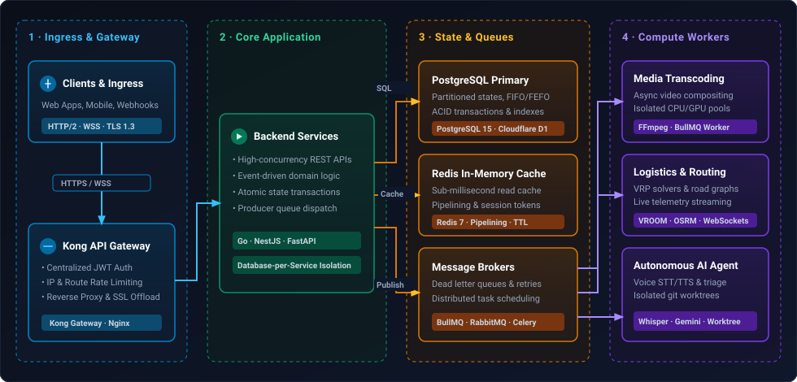

# Nurbek Abildaev

### Backend & Distributed Systems Engineer

> Backend engineer specializing in **event-driven distributed systems**, **high-concurrency APIs**, and **production data pipelines**. Focused on database performance optimization, resilient worker topologies, and measurable business impact.

---

### 🏛 Architectural Blueprint & System Topology

  <picture>
    <source media="(prefers-color-scheme: dark)" srcset="assets/architecture-dark.svg">
    <source media="(prefers-color-scheme: light)" srcset="assets/architecture-light.svg">
    
  </picture>

  <em>Standard event-driven microservices architecture I design and implement for high-load systems (Go/NestJS, PostgreSQL, Redis, BullMQ/RabbitMQ).</em>

  <code>Golang</code> · <code>TypeScript</code> · <code>Python</code> · <code>NestJS</code> · <code>FastAPI</code> · <code>PostgreSQL</code> · <code>Redis</code> · <code>Kong API Gateway</code> · <code>BullMQ</code> · <code>Docker</code> · <code>Linux</code>

---

### 🛠 Core Technical Stack

| Domain | Technologies & Frameworks |
| :--- | :--- |
| **Languages** |     |
| **Backend Frameworks** |    |
| **Queues & Asynchronous** |     |
| **Databases & Storage** |    |
| **Infrastructure & DevOps** |      |

---

### 🚀 Production & Engineering Highlights

* **Voice-Driven Engineering Agent ([jarvis-dev-agent](https://github.com/NURJAKS/jarvis-dev-agent)):**
  Built a terminal-native AI agent that routes multilingual voice commands (RU/KZ/EN/KO) through a Whisper STT pipeline into real workflows: pre-flight diff review with PR generation, GitHub Actions failure triage, git pickaxe archaeology and **autonomous tasks in isolated git worktrees**, backed by a **Gemini → Groq → Ollama** failover chain.

* **Distributed Media Generation Pipeline ([ai-video-generator-saas](https://github.com/NURJAKS/ai-video-generator-saas)):**
  Architected an asynchronous video composition engine using **NestJS**, **BullMQ**, and **FFmpeg**. Quarantined compute-heavy AI rendering workflows into isolated worker queues, maintaining **sub-50ms API response latencies** while streaming bidirectional progress updates over WebSockets.

* **Database Optimization & Inventory State Machines (B2B SaaS WMS):**
  Engineered atomic FIFO/FEFO inventory allocation logic in PostgreSQL. Optimized complex relational queries and implemented **Redis pipelining** for high-load transaction paths, reducing P95 API response times from **2.5s down to 0.5s** (80% latency reduction).

* **Edge-Native Serverless Architecture ([edge-serverless-crm](https://github.com/NURJAKS/edge-serverless-crm)):**
  Engineered an edge-native CRM portal deployed across **Cloudflare Workers** and **Cloudflare D1** distributed SQL storage, leveraging Web Crypto JWT authentication for sub-10ms global edge execution.

* **Microservices Task Orchestration ([distributed-kanban-microservices](https://github.com/NURJAKS/distributed-kanban-microservices)):**
  Implemented a cloud-native Kanban platform enforcing the **Database-per-Service** pattern across decoupled PostgreSQL instances, orchestrated via **Kong API Gateway** (centralized JWT validation, rate limiting) with **Celery & Redis** asynchronous workers.

* **Real-Time Fleet Routing Engine ([smart-logistics-engine](https://github.com/NURJAKS/smart-logistics-engine)):**
  Developed a containerized routing backend composing OpenStreetMap road networks (**OSRM**), vehicle routing problem solvers (**VROOM**), and ML-based delay estimation with live WebSocket dispatch telemetry.

* **Threat Intelligence & LLM Security ([phishguard-threat-intelligence](https://github.com/NURJAKS/phishguard-threat-intelligence)):**
  Built a real-time anti-phishing engine combining lexical parsing, WHOIS/SSL telemetry, and multi-LLM security triage streaming live detections via Server-Sent Events (SSE).

* **AI Tooling & Codebase Intelligence ([zod-mcp-server](https://github.com/NURJAKS/zod-mcp-server)):**
  Created an extensible **Model Context Protocol (MCP)** server providing AST-based code transforms, hybrid semantic vector search, and persistent agent memory.

---

### 📂 Featured Architectural Repositories

| Repository | Architecture & Focus | Core Stack |
| :--- | :--- | :--- |
| [jarvis-dev-agent](https://github.com/NURJAKS/jarvis-dev-agent) | Voice-first AI agent, intent routing, multi-provider LLM failover | Python, Whisper, Gemini, Groq, Ollama, FFmpeg |
| [ai-video-generator-saas](https://github.com/NURJAKS/ai-video-generator-saas) | Event-driven media pipeline, worker pools, real-time telemetry | NestJS, BullMQ, Redis, FFmpeg, Angular |
| [distributed-kanban-microservices](https://github.com/NURJAKS/distributed-kanban-microservices) | Database-per-Service isolation, API Gateway pattern | Python, Flask, Kong, PostgreSQL, Celery |
| [smart-logistics-engine](https://github.com/NURJAKS/smart-logistics-engine) | Real-time vehicle routing solver & fleet dispatch engine | FastAPI, OSRM, VROOM, WebSockets, Docker |
| [zod-mcp-server](https://github.com/NURJAKS/zod-mcp-server) | Context protocol server for LLM agents & semantic search | TypeScript, MCP Protocol, Vector Search |
| [edge-serverless-crm](https://github.com/NURJAKS/edge-serverless-crm) | Edge-native distributed serverless CRM & client portal | Cloudflare Workers, D1 SQL, React 18 |
| [phishguard-threat-intelligence](https://github.com/NURJAKS/phishguard-threat-intelligence) | Threat intelligence & anti-phishing heuristic analysis engine | PHP, Python, LLM Security, SSE |
| [freelance-aggregator-pipeline](https://github.com/NURJAKS/freelance-aggregator-pipeline) | Resilient ingestion pipeline with deduplication & alert queues | Python, Asyncio, Telegram API, SQLite |
| [omnichannel-lead-router](https://github.com/NURJAKS/omnichannel-lead-router) | Omnichannel CRM & lead routing service with webhook pipelines | FastAPI, Aiogram 3, WhatsApp API, Sheets |

---

<!-- DYNAMIC_PROFILE:START -->

  💭 Architectural Principle: <i>"Premature optimization is the root of all evil, but premature distribution is the architect's nightmare. Keep boundaries clean."</i>

<!-- DYNAMIC_PROFILE:END -->
